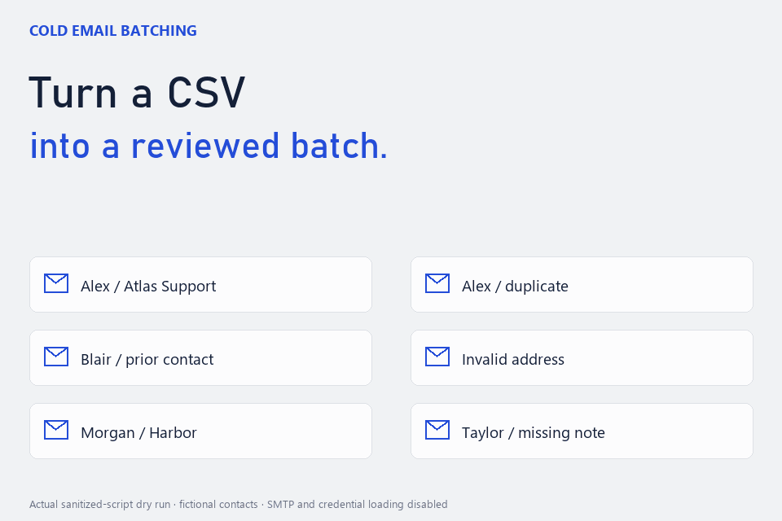

# Cold Email Batching

Python batch processing with address validation, duplicate checks, prior-contact exclusion, personalized previews, daily limits, delays, and CSV outcome logs.

The sanitized scripts default to `DRY_RUN = True`. No personal contact lists, credentials, CV files, or sending history are included. Replace the generic template and configure your own inputs before use. Daily limits are local settings, not guarantees of provider allowance or delivery.

Run `python examples/preview_demo.py` for a fictional preview that blocks SMTP and does not read credentials. The public demo sends no email.

## Demo

The demo records actual local interactions with fictional inputs. Cursor movement, camera zooms and captions are added for readability. See CREDITS.md for the exact recording setup.

## Source references

See [Credits and source references](CREDITS.md) for the upstream tools, libraries and fonts used, and details of the workflow recording.

A separate [fictional review-interface example](examples/review_ui/README.md) supports recipient selection, note editing and generated drafts. It cannot send email or access the private campaign.

[Download the full-motion recording](docs/demo.mp4).
